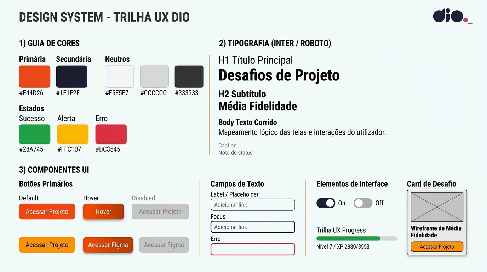

# 🎨 Desafio de Projeto: Construindo um Design System

Solução desenvolvida para o desafio prático da **DIO**, com o objetivo de criar um Design System completo baseado no wireframe desenvolvido anteriormente, aplicando diretrizes visuais, guia de cores, componentes reutilizáveis e padrões de interação.

---

## 🎯 Objetivo
Estruturar um Design System consistente que sirva como "fonte da verdade" para a interface, garantindo escalabilidade, coesão visual e agilidade no desenvolvimento de produtos digitais.

---

## 🛠️ Ferramentas e Conceitos
* **Ferramenta de Design:** Figma
* **Conceitos Aplicados:** Tokens de Design, Paleta de Cores, Tipografia, Componentes Reutilizáveis (Buttons, Inputs, Cards) e Documentação de Estados.

---

## 🚀 O que foi desenvolvido

### 🎨 Guia de Cores (Tokens)
* **Primária (Ação / Destaque):** `#E44D26` (Laranja vibrante para botões principais e progresso)
* **Secundária (Estrutura / Cabeçalhos):** `#1E1E2F` (Azul-marinho escuro para contrastes e barras de navegação)
* **Neutros:** `#F5F5F7` (Fundo claro), `#CCCCCC` (Bordas e divisores), `#333333` (Texto principal)
* **Semânticas / Estados:** Sucesso (`#28A745`), Alerta (`#FFC107`), Erro (`#DC3545`)

### ✍️ Tipografia (Inter / Roboto)
* **H1 (Título Principal):** 28px / Bold
* **H2 (Subtítulo de Seção):** 20px / SemiBold
* **Body (Texto Corrido):** 16px / Regular
* **Caption / Labels:** 12px / Medium

---

## 🖼️ Pré-visualização do Design System

---
