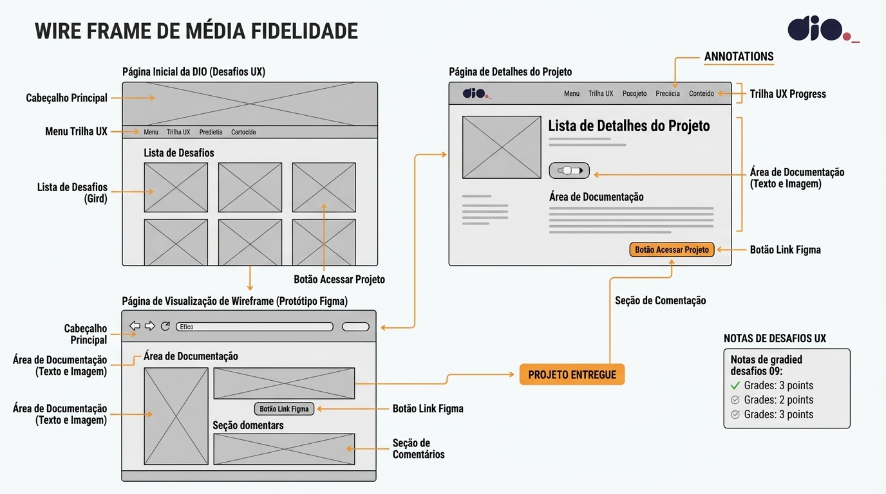

# 📱 Desafio de Projeto: Criar um Wireframe de Média Fidelidade

Solução desenvolvida para o desafio prático da **DIO**, com foco na estruturação da experiência do utilizador (UX) e no planeamento visual de uma interface digital.

---

## 🎯 Objetivo
Projetar um wireframe de média fidelidade para definir o fluxo de navegação, a disposição dos elementos (layout) e a hierarquia da informação de uma aplicação, servindo de base antes da etapa de design visual (UI).

---

## 🛠️ Ferramentas e Conceitos
* **Design:** Arquitetura da Informação, User Flow e Usabilidade

---

## 🚀 O que foi aplicado
* **Estruturação de Layout:** Organização de cabeçalhos, menus, blocos de conteúdo e botões de ação.
* **Fluxo de Navegação:** Mapeamento lógico das telas e interações do utilizador.
* **Média Fidelidade:** Uso de componentes estruturados em escala de cinza para validar a funcionalidade sem distrações estéticas.

---
## 🖼️ Pré-visualização do Wireframe

